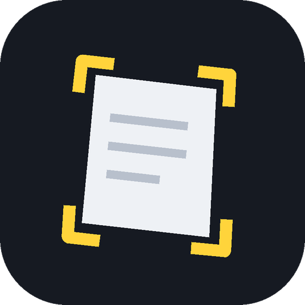
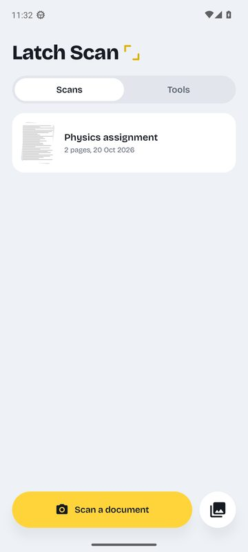
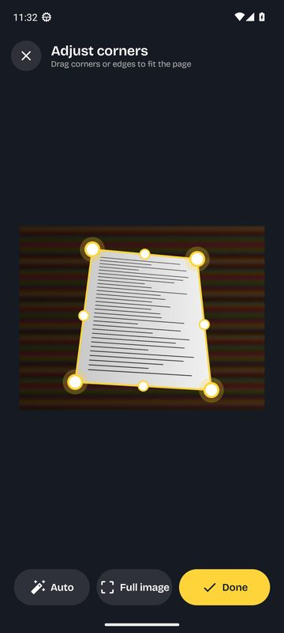
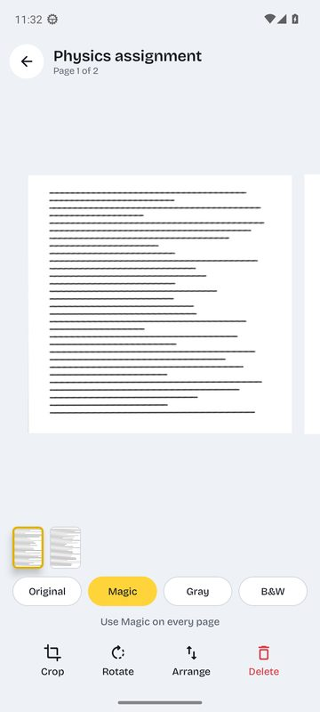
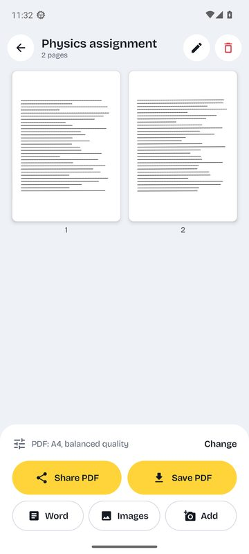
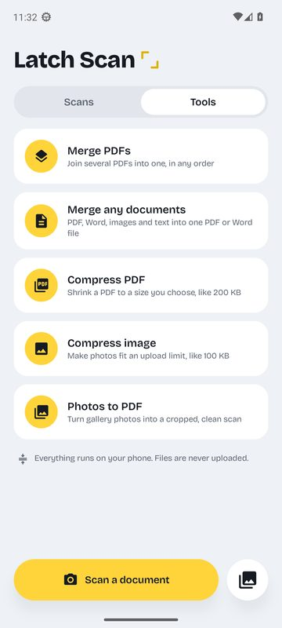
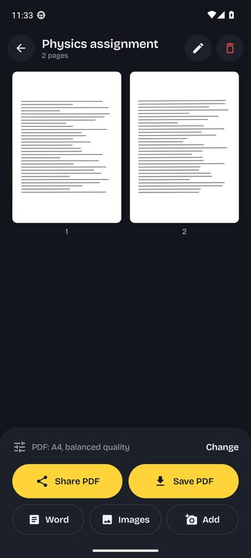

# Latch Scan

An Android document scanner and PDF toolkit. Put a page on a table, point the camera at it, and Latch Scan finds the edges, waits until the page is steady, and takes the photo for you. It then flattens the perspective and cleans up the page.

Everything runs on the phone. The app has no internet permission.

<p align="center"></p>

<p align="center">






</p>

## Download

Get **LatchScan.apk** from the [latest release](../../releases/latest) and open it on your phone. Android will ask you to allow installs from your browser or file manager the first time.

Every push to `main` builds a new APK and AAB automatically (see [Actions](../../actions)).

## Features

### Scanner
- **Auto mode.** Live edge detection (OpenCV) draws a yellow outline that springs onto the page. When the page has held still for about a second, the app takes the photo: the shutter ring fills up, then the flash, haptic tick and shutter sound fire. Swap in the next page and it captures again, so multi-page assignments go quickly.
- **Manual mode.** Toggle **Auto / Manual** at the top. Take the photo yourself, then drag the four corners or any edge to crop. A magnifier shows what's under your finger, *Auto* re-detects the edges, and *Full image* resets the crop.
- **Front & back mode.** Guided capture of the front, then the back, with a flip animation. You can keep the two sides as separate pages or put both on one A4 page, ID-card style.
- **Filters:** Original (the default), Magic (removes shadows, whitens paper, keeps colour ink), Gray, B&W. Apply one page at a time or to every page.
- Rotate, re-crop, delete and drag-to-reorder pages. Torch, tap-to-focus, and import from the gallery (photos are auto-cropped too).

### Your scans
- Saved in the app. Search, rename, delete, or add more pages later.
- Export as **PDF** (page size: fit to page, A4 or Letter; quality: High, Balanced or Small), as **Word (.docx)**, or as JPG images.
- **Share** to any app, or **Save** straight to `Downloads/Latch Scan`.

### Tools
| Tool | What it does |
|---|---|
| Merge PDFs | Joins PDFs in the order you set (long-press and drag). Pages aren't re-encoded, so text stays selectable. |
| Merge any documents | Combines PDFs, Word (.docx), images and text files into one **PDF** or one **Word** file. With a single file, it converts that file. |
| Compress PDF | Shrinks a PDF to a target size (100 KB, 200 KB, 500 KB, 1 MB… or custom). It picks the sharpest resolution and quality that fit. |
| Compress image | Gets one or many photos under a size limit (for exam and job portals), as JPG or WebP, with optional resizing. |
| Photos to PDF | Turns gallery photos into cropped, cleaned scans. |

## Build it yourself

Requirements: Android Studio (Ladybug or newer) or JDK 17 plus the Android SDK.

```bash
./gradlew assembleRelease      # APK  -> app/build/outputs/apk/release/
./gradlew bundleRelease        # AAB  -> app/build/outputs/bundle/release/
./gradlew testReleaseUnitTest  # unit tests
```

Stack: Kotlin, Jetpack Compose (Material 3), CameraX, OpenCV 4, ONNX Runtime (DocAligner corner model), PdfBox-Android, Coil. The model file is downloaded automatically on the first build (see `fetchModels` in `app/build.gradle.kts`). Licences: [THIRD_PARTY_NOTICES.md](THIRD_PARTY_NOTICES.md). minSdk 24 (Android 7.0), targetSdk 35.

### How auto-capture works
1. CameraX streams 640×480 colour frames to an analyzer, which turns each one upright.
2. Three detectors look for the page together:
   - **Corner AI**: the DocAligner heatmap network (~5 MB, ONNX Runtime). It copes with white paper on white tables, clutter and soft shadows.
   - **Contour detector** (OpenCV): it finds precise edges, including pages that nearly fill the frame.
   - **Line detector**: if the AI sees a page but some corners are hidden (an open book), it builds the page from straight edges and the book's gutter.

   When the AI and the contours agree, the contour corners are used, because they sit exactly on the paper edge.
3. The screen springs the outline toward each new detection. Once every corner stays within ~2% for 1.1 s, the app takes a full-resolution photo, re-detects the corners on it, and perspective-warps the page.
4. Auto mode won't fire again until the page is removed or moved, so you won't get duplicates.

## Testing

Every push runs three layers of checks on GitHub Actions:

- **Unit tests** (JVM): auto-capture timing (`LatchTrackerTest`), corner geometry, and the Word reader/writer.
- **Device tests** on an Android 13 emulator (Pixel 6): page detection on test photos (dark and light tables, wood grain, a pen across the page, a shadow, and an empty table), filters, PDF build/merge/compress-to-size, image compress-to-size, mixed-document merge to PDF and Word, and saving/exporting a scan.
- **A full UI walk-through** in light and dark mode: home, every tool, document, PDF settings, rename, page editor, arrange, crop, live camera (auto, manual, front & back), manual capture, review and save. Screenshots of every screen are pushed to the `ci-artifacts` branch.

The build also checks that every native library supports 16 KB memory pages, which Google Play requires for apps targeting Android 15+.

## Publishing to Google Play

The CI signs builds with a bundled **test key** (`app/latch-ci.jks`), so every build installs over the last one. **Don't use that key for the Play Store.** Before publishing:

1. Create your own upload key:
   `keytool -genkeypair -v -keystore upload.jks -alias upload -keyalg RSA -keysize 2048 -validity 10000`
2. Add these repository secrets (Settings → Secrets and variables → Actions): `LATCH_KEYSTORE_BASE64` (the output of `base64 -w0 upload.jks`), `LATCH_KEYSTORE_PASSWORD`, `LATCH_KEY_ALIAS` and `LATCH_KEY_PASSWORD`. The workflow picks them up automatically.
3. Upload `LatchScan.aab` from the release to the Play Console, and turn on Play App Signing.
4. Store listing: use `PRIVACY.md` as the privacy policy (host it, e.g. with GitHub Pages). In the Data safety form, declare **no data collected or shared**.
5. Change `applicationId` in `app/build.gradle.kts` if you want a different package name. It can't be changed after the first upload.

## Project layout

```
app/src/main/java/com/mithun/latchscan/
  scanner/   camera screen, edge detection, crop editor, page editor, image filters
  tools/     PDF build/merge/compress, image compression, DOCX read/write, merge engine
  data/      document model and on-device storage
  ui/        home, document, tool screens, theme and shared components
```

## Privacy

See [PRIVACY.md](PRIVACY.md). In short: no network access, no data collection.
